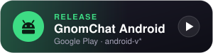

<h2 align="center">Trykk her gutta når du har lagd noe</h2>

<p align="center">
  Lag en ny release for å få endringene dine ut på Gnomguttan: trykk på knappen for appen du har endret, trykk <b>Run workflow</b> og la den bygge.<br />
  <b>Web:</b> velg stage <code>production</code>. Når workflowen er ferdig, henter serveren den nye versjonen selv innen 10 minutter. Du trenger ikke si ifra til noen, bare vent.<br />
  <b>Android:</b> GnomChat sendes rett til Google Play-sporet for stagen du velger.
</p>

<p align="center">
  <a href="https://github.com/jensmjahle/gnomguttan/actions/workflows/release-android.yml"></a>
  <a href="https://github.com/jensmjahle/gnomguttan/actions/workflows/release-web.yml"></a>
</p>

<p align="center">
  <a href="https://github.com/jensmjahle/gnomguttan/releases?q=android-v"></a>
  <a href="https://github.com/jensmjahle/gnomguttan/pkgs/container/gnomguttan"></a>
</p>

# Gnomguttan

Gnomguttan er en liten startside for VoceChat, kalender, galleri, Hubert Cinema og arkivvisning.

App-data som brukere, arrangementer og overhørt lagres nå i MongoDB via den innebygde Node-serveren.
I lokal utvikling starter serveren en midlertidig in-memory MongoDB hvis `MONGODB_URI` mangler eller ikke kan nås.

## Development

```bash
npm install
npm run dev
```

Use Node.js 22 or newer. The optional Matrix bot uses the native Rust crypto SDK.

`npm run dev` starter både API-serveren og Vite-klienten.

Chat2.0 har også en separat [Matrix-informasjonsbot](docs/matrix-info-bot.md) for arrangementsvarsler.
Den kan bruke kontoen «gnomen» og kjører parallelt med den eksisterende VoceChat-boten.

## Environment

Set these values in `.env` or `docker-compose.yml`:

- `MONGODB_URI`: connection string for MongoDB, normally with username and password
- `MONGODB_DB`: database name used by the app, or leave blank to use the database name from the URI
- `PORT`: port for the Node server
- `APP_API_TARGET`: optional local Vite proxy target for `/app-api`
- `VOCECHAT_HOST`: direct VoceChat base URL
- `APP_TITLE`: app title shown in the navbar
- `VOCECHAT_BOT_TARGET_GROUP_ID`: VoceChat group/channel ID that receives info-bot announcements
- `VOCECHAT_BOT_API_KEY`: VoceChat bot API key used by the container-side proxy, event reminders, and GnomChat background push bridge
- `JELLYFIN_HOST`: direct Jellyfin server URL used for metadata and posters
- `JELLYFIN_CLIENT_URL`: public Kino URL used when opening movie and series pages
- `JELLYFIN_TOKEN`: Jellyfin API token used by the runtime proxy
- `HOME_ASSISTANT_URL`: Home Assistant base URL reachable from the server, without a trailing slash
- `HOME_ASSISTANT_TOKEN`: long-lived Home Assistant access token used only by the server-side proxy
- `HOME_ASSISTANT_ENTITY_ID`: optional entity id for the widget, defaults to `switch.lampa_til_jens`
- `HOME_ASSISTANT_LIGHT_ENTITY_ID`: legacy alias still accepted for older setups
- `GITHUB_TOKEN`: fine-grained personal access token for the Dev page, scoped to only the gnomguttan repo. Repository permissions: Issues (read & write), Pull requests (read), Contents (read & write — for releases and pasted/uploaded images), Actions (read), Metadata (read). The Kanban board derives status from issue state + an `in-progress` label, so no GitHub Projects access is required.
- `GITHUB_REPO`: GitHub repo in `owner/repo` format used by the Dev page, defaults to `jensmjahle/gnomguttan`
- `VALHEIM_SERVER_ADDRESS`: address of the Valheim server, e.g. `192.168.0.190:2456`
- `VALHEIM_SERVER_PASSWORD`: password shown on the Valheim page
- `VALHEIM_JOIN_CODE`: crossplay join code shown on the page, set by hand
- `VALHEIM_WORLD`: world name shown on the card; Valheim does not report it over the network
- `VALHEIM_PUBLIC_ADDRESS`: address shown to players instead of `VALHEIM_SERVER_ADDRESS`

The widget polls Home Assistant automatically every 5 seconds and refreshes when the tab becomes active again.

## Valheim Server

`Tjenester -> Valheim Server` shows who is on the server, which world it runs,
its version and response time, plus the address, password and join code players
need to get in.

It works by speaking Valheim's own query protocol — the same Steam A2S_INFO the
game's server browser uses — against the address in `VALHEIM_SERVER_ADDRESS`.
The query port is the game port + 1, so `192.168.0.190:2456` is queried on 2457.
That means no Docker, no agent and no configuration on the server itself; it just
has to be reachable from wherever this app runs.

### How to play

The page carries a step-by-step guide for players: install WireGuard, get a
personal config from the admin, import it, switch it on, then join by IP from
inside Valheim. The server is not exposed to the internet, so the VPN is what
makes it reachable at all.

### Limits worth knowing

- **Player names are not available.** The page also sends A2S_PLAYER, the Steam
  query that returns names and session lengths, and renders them when they come
  back — but Valheim answers it with an empty list (verified against a live
  0.221.12 server). You get the count, not who. If Valheim ever starts filling
  it in, the names appear on their own.
- **Valheim lies in two A2S fields.** It puts the server name in `map` instead of
  the world name, and reports its version as `1.0.0.0`. Both are hidden when
  they carry no information; set `VALHEIM_WORLD` to show the world name.
- **The join code cannot be read over the network.** Valheim only prints it to
  the server console, so `VALHEIM_JOIN_CODE` is set by hand and has to be updated
  if it changes. It only exists at all when the server runs with `-crossplay`.
- **There is no start/stop.** Controlling the container needs Docker access,
  which this page deliberately does not have.

## Release flow

Releases are created manually in GitHub as version tags. The Docker workflow only runs on `v*` tags.

1. Create a new tag in GitHub, or locally with `git tag vX.Y.Z` and `git push origin vX.Y.Z`
2. Use `major`, `minor`, or `patch` based on the change type
3. GitHub Actions builds and publishes the Docker image from that tag
4. In CasaOS, update or recreate the container to pull the newest image tag (Dette må Jens Martin gjøre)

Version meaning:

- `major`: breaking changes
- `minor`: new functionality without breaking changes
- `patch`: bug fixes and small adjustments

Example tags:

- `v1.0.0`
- `v1.1.0`
- `v1.1.1`

## Themes

Themes are defined in two places:

- **CSS variables** – colors, background, etc. in `src/styles/themes.css`
- **Metadata** – name, description, and grouping in `src/config/themes.ts`

### Adding a new theme

**1. Register the theme in `src/config/themes.ts`**

Add an entry to an existing group, or create a new group:

```ts
// Existing group
{ id: 'mytheme', label: 'My Theme', description: 'Description here' }

// Or a new group
{
  label: 'Community',
  themes: [
    { id: 'mytheme', label: 'My Theme', description: 'Description here' },
  ],
},
```

The `id` must be unique and contain only letters and hyphens.

**2. Add CSS variables in `src/styles/themes.css`**

Copy an existing block and adjust the values:

```css
:root[data-theme='mytheme'] {
  --bg-image:      none; /* or url('/images/mytheme.png') */
  --footer-color:  #111118;

  --bg-primary:    #ffffff;
  --bg-secondary:  #f4f4f6;
  --bg-hover:      #eaeaed;
  --bg-card:       #ffffff;

  --text-primary:   #111118;
  --text-secondary: #6b6b80;
  --text-muted:     #9a9aaa;

  --accent:        #6366f1;
  --accent-hover:  #4f52e3;
  --accent-muted:  #eef2ff;
  --accent-fg:     #ffffff;

  --border:        #e2e2e8;
  --border-strong: #c8c8d4;

  --error:         #ef4444;
  --success:       #22c55e;
  --warning:       #f59e0b;

  --navbar-bg:     #ffffff;
  --chat-bg:       #f9f9fb;
  --msg-self-bg:   #eef2ff;
  --msg-other-bg:  #ffffff;
}
```

Shadows, border-radii, font, and transition are global design tokens defined once in `themes.css` — do not add them to theme blocks.

**3. Optional: add a background image**

Place the image in `public/images/` and set `--bg-image` in the CSS block:

```css
--bg-image: url('/images/mytheme.png');
--footer-color: #111118; /* adjust for readability against the background */
```


## StreamDeck

The home page contains a StreamDeck widget — a grid of icon tiles in the bottom-right panel. Tapping a tile either fires a button action immediately or opens a full widget inside the box (with × to return to the grid). When there are more than six entries the grid paginates automatically.

### Adding a new button

**All changes happen in one file: `src/components/widgets/StreamDeckBox.tsx`.**

There are three entry kinds:

| Kind | Behaviour |
|---|---|
| `'widget'` | Tap opens the full component in the box. × returns to the grid. |
| `'custom'` | A pre-built tile component with its own state/animations (e.g. live on/off indicator). |
| `'button'` | Tap fires `onPress` immediately; tile flashes accent colour. |

**Example — adding a simple button:**

```tsx
{
  label:   'My Button',
  icon:    <MyIcon />,
  kind:    'button',
  onPress: () => doSomething(),
},
```

**Example — adding a feature widget:**

```tsx
{
  label: 'My Feature',
  icon:  <MyIcon />,
  kind:  'widget',
  node:  <MyWidget />,
},
```

**Example — adding a stateful custom tile:**

Create a component in `src/components/widgets/` that uses the exported `TileButton` for consistent styling.
`LampaTile` and `MjauTile` are good references. `MjauTile` shows the typical pattern for a button that reacts to a server-sent event with an icon animation:

```tsx
// MyTile.tsx
import { useEffect, useState } from 'react';
import { useAuthStore } from '@/store/authStore';
import { TileButton } from './StreamDeck';

export function MyTile() {
  const [active, setActive] = useState(false);

  useEffect(() => {
    const token  = useAuthStore.getState().token ?? '';
    const source = new EventSource(`/app-api/my-event?token=${encodeURIComponent(token)}`);
    source.onmessage = () => {
      setActive(true);
      setTimeout(() => setActive(false), 600);
    };
    return () => source.close();
  }, []);

  return (
    <TileButton label="My Thing" onClick={() => doSomething()}>
      <span
        style={{
          display:    'inline-block',
          transition: 'transform 0.15s ease',
          transform:  active ? 'scale(1.3) rotate(-10deg)' : 'scale(1)',
        }}
      >
        🐾
      </span>
    </TileButton>
  );
}
```

Then add it to the registry:

```tsx
{ label: 'My Thing', kind: 'custom', tile: <MyTile /> },
```

### Cat popup suppression

The Mjau meow triggers a cat animation in the Navbar for all connected clients. If a button should fire the meow without showing the cat popup on the **local** client, call `suppressNextCat()` before `triggerMeow()`:

```ts
import { triggerMeow, suppressNextCat } from '@/services/meow';

suppressNextCat();
triggerMeow().catch(() => {});
```

Other clients are unaffected and will still see the cat.

---

## Releases

Ship a new version: each button opens that app's release workflow, where you press **Run workflow** and pick the bump and stage.

<p align="center">
  <a href="https://github.com/jensmjahle/gnomguttan/actions/workflows/release-android.yml"></a>
  <a href="https://github.com/jensmjahle/gnomguttan/actions/workflows/release-web.yml"></a>
</p>

Each app is released on its own from **Actions**, with its own [semantic version](https://semver.org/) and tag line. The live version of each app is in the badges at the top of this README.

| App | Workflow in Actions | Tags | Ships to |
|---|---|---|---|
| GnomChat Android | **Release · GnomChat Android** ([`release-android.yml`](./.github/workflows/release-android.yml)) | `android-v*` | Google Play track for the stage |
| Web | **Release · Web** ([`release-web.yml`](./.github/workflows/release-web.yml)) | `web-v*` | Docker image `ghcr.io/jensmjahle/gnomguttan:v<version>`, plus `:latest` for production |

Each Release workflow takes:

| Input | Choices |
|---|---|
| Bump | `patch`, `minor`, `major`, or `keep` (same version, next stage) |
| Stage | `alpha` → Play closed testing, `beta` → open testing, `production`. For web, only `production` moves `:latest`, which `docker-compose.yml` pulls |
| Notes | Optional release notes; generated from merged PRs when empty |
| Dry run | Only compute and show the next tag |

It computes the app's next tag from the existing tags, creates the tag and GitHub Release on the current `main` commit ([`create-release.yml`](./.github/workflows/create-release.yml)), builds and ships the app, and then records the version in [`.github/versions.json`](./.github/versions.json) on `main` ([`record-version.yml`](./.github/workflows/record-version.yml)), which the badges read. A failed build keeps showing the last version that shipped. Web continues from the last `v*` release (`v0.7.1`), and GnomChat continues from `1.0.0`, the version it already ships as.

Typical flow:

1. Release with `patch` + `alpha` → `android-v1.0.0` becomes `android-v1.0.1-alpha.1`
2. Fix bugs on `main`, then `keep` + `alpha` → `android-v1.0.1-alpha.2`
3. Promote the same code with `keep` + `beta` → `android-v1.0.1-beta.1`
4. Ship with `keep` + `production` → `android-v1.0.1`

The workflows refuse tags that already exist, going back from beta to alpha, or prereleasing a version that is already in production. The version logic lives in [`scripts/release/next-version.mjs`](./scripts/release/next-version.mjs) and can be run locally:

```bash
node scripts/release/next-version.mjs --prefix web-v --start 0.7.1 --bump patch --stage production
```

### Automatic deploy of the web app

The server (CasaOS) runs the compose app from `ghcr.io/jensmjahle/gnomguttan:latest`, and a root cron job checks GHCR every 10 minutes and restarts the container when `latest` points at a new image:

```bash
*/10 * * * * cd /var/lib/casaos/apps/nurturing_matheson && docker compose pull -q && docker compose up -d >> /var/log/gnomguttan-update.log 2>&1
```

So a web release with stage `production` is live within 10 minutes after the workflow finishes, with no manual step. `alpha` and `beta` releases don't move `latest` and are not deployed. CasaOS doesn't ship the `docker compose` CLI, so the plugin is installed by hand in `/usr/local/lib/docker/cli-plugins/docker-compose`. The log is in `/var/log/gnomguttan-update.log`.

Every merge to `main` that touches `gnomchat/` still sends a build to the Play **internal testing** track ([`gnomchat-android.yml`](./.github/workflows/gnomchat-android.yml)). If `main` is protected so `GITHUB_TOKEN` cannot push to it, add a `RELEASE_PUSH_TOKEN` secret that may, so the badges can be updated.
## Ølbørs

Ølbørs er integrert under Gnomoseum med Gnomguttan-innlogging, egne børsroller,
MongoDB, historikk og separat kioskmodus. Se [integrasjon og migrering](docs/olbors.md).
